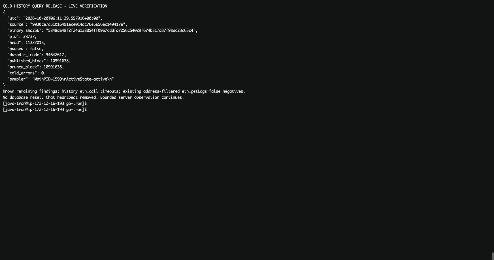

# 冷历史查询修复发布与线上复测

用户已批准撤销本线程定时巡检、推送部署并继续采样。`compact-v3` 聊天定时任务已删除。
源码 **9030ce7a31016491ece014ac76e5656ec149417e** 已推送 master，并于 **2026-10-20 13:36:15 北京时间**完成原发布流程的健康检查。
运行二进制 SHA256：`5848de48f2f24a128054ff0967cddfd7256c54029f674b317d37f98ac23c63c4`；PID **28737**。

**发布已完成，慢查询只得到部分改善，历史 eth_call 仍未达到目标。**

## 发布与数据保留

自动发布此前反复失败于 `go test ./...` 的包发现阶段：旧的 `build/deploy.6y7fjwyf` 是 10 月 18 日留下的 root/0700 私有目录，java-tron 发布用户无法遍历。
确认无进程占用后，已将其完整移至服务器证据目录 `retained-private-build-temp`，保留二进制和原权限。
Rust Cargo.lock 仅格式规范化，95 个包名和版本一致。

修复环境后，原有**全量 Sapling 套件**通过，64 个含测试的包通过，包括 core 458.096 秒、state 5.411 秒、snapshots 156.783 秒；随后原生构建及 root release helper 验证通过。
日志记录 05:36:01 UTC 开始停服、05:36:07 新进程启动、05:36:15 健康检查通过；启动游标为 **11,219,269**，继续同步。

`/data/gtron/main/datadir` inode 仍为 **94642617**。保留旧库 `/data/gtron/main/datadir-pre-compact-v3-20261019-659ab078` 的 27,652 个文件元数据清单 SHA256 仍为
`318de55a385e3a506bf37463a228fe2a91803b26a7e2eecd0d92af2b2a5165fb`。
库格式、服务参数和内存预算未调整；不是从创世重同步。此次随后只重启过只读采样进程。

## 相同本机 RPC 探针

服务器 loopback，固定相同请求、15 秒客户端截止、串行三轮，每轮八项；以下为三项样本中位数。
两版的 HEAD、进程、缓存及同步负载不同，未清空页缓存，**不是固定高度 A/B，也不足以估计 p95**。

| 查询 | 原版 | 新版 |
| --- | ---: | ---: |
| 创世发送方余额 | 1,604.56 ms | **35.44 ms** |
| slot 0，3,144,020 高度，期望 6 | 6,065.51 ms | **4,303.34 ms** |
| slot 0，3,144,021 高度，期望 7 | 5,289.69 ms | **4,628.93 ms** |
| 接收方 341 高度余额 | 33.57 ms | 33.29 ms |
| 接收方 342 高度余额 | 54.42 ms | 36.17 ms |
| latest slot 对照 | 5.24 ms | 5.77 ms |
| 两个高度的历史 eth_call | 6 次中 1 次超过 15 秒 | **6 次中 4 次超过 15 秒** |

原版 24 次中 23 次正确返回、1 次超时；新版 24 次中 20 次正确返回、4 次超时，所有已返回的固定业务值均正确。
表中不将超时的 15 秒客户端持续时间冒充真实完成耗时。
额外有界 profile 工作负载为 12 次请求，9 次正确返回、3 次超时，独立保存，不混入表格。
持续采样中的两个槽位还出现约 5.55–6.34 秒的样本，说明槽位查询仍有明显波动。
离线 227,222 副本的余额/正确性验收没有覆盖当前 11M 高度密集热尾部下的完整 eth_call 性能，本轮补出了这个缺口。

## 已定位的主要成本

05:43:12 UTC 的 15.11 秒 CPU profile 与有界查询重叠，总进程 CPU 样本 56.18 秒。
其中历史 RPC 调用栈累计 **14.74 CPU 秒**：

- 热变化集范围遍历 `IterateStateDomainChangesByBlockRangeContext` **11.58 CPU 秒**，约为上述历史 RPC 栈 CPU 的 **78.6%**。
- `decodePersistedStateDomainChangeBlock` **11.29 CPU 秒**、RLP 解码 **9.20 CPU 秒**是前者的嵌套成本，不能相加。
- 冷库批量点查 **3.10 CPU 秒**。同一窗口内 eth_call 的 **4.94 CPU 秒**落在历史动态参数准备路径 `LoadDynamicPropertiesStrict`，尚不能把整项耗时归因于 TVM 解释执行。

阶段 API 一次采样的 Finish/Execution = **11,245,761**，StateHistoryIndex = **11,244,090**，均有规范块哈希验证，差值 **1,671 块**。
这是阶段 API 的采样差值，不是对某个 RPC 已固定视图内 pack 数量或字节数的全量统计。
另一个 05:41:48 profile 中，槽位 RPC 栈 14.60 CPU 秒，热范围扫描 10.84 CPU 秒，结论一致。

本次正确性修复将 posting 负查后的直接返回改为继续检查未索引尾部。
这使以前可能遗漏的尾部真正被读取；对冷库无后续变化的键，仍需证明热尾部没有变化。
源码、两个 profile 与阶段水位共同指向：**当前优先优化同一查询中重复的热 pack 解码与索引尾部成本**。
不能为了提速恢复跳过尾部的旧行为。

缓存边界另作记录：manifest generation 4,784 有 4,292 个 state history 段；本次 cut 后有 3,906 段，段头加 accessor 头潜在 7,812 项，缓存上限 8,192。
该统计没有测生产命中率，不能据此断言已发生缓存抖动，也不能用扩大头缓存替代热尾部优化。

## 新发现的独立历史日志问题

交易 `bbda20c284266036e65d2b91de12bc974262ac9d051f9cac08c63c5ead029363` 的回执和无地址过滤的同块 eth_getLogs，其地址、topics、data、块/交易哈希、块号和两个索引一致；
但带 `address=0xa4997124a328a4615eab437cede31da47a31b375` 的查询返回 **[]**。
此项明确记录为失败。

定位到地址表示不一致：RPC 过滤地址解析为 21 字节、前缀 0x41；20 字节 TVM log 经 `BytesToAddress` 左补零，前缀为 0x00，独立探针确认 payload 比较也会失败；后续修复须覆盖冷索引预过滤和 backend 过滤链路。
`core/tron_backend.go`、`internal/jsonrpc/address.go`、`common/address.go` 在 659ab078 与 9030ce7a 的 Git blob 完全相同。
独立 overlay 探针已复现这一已有缺陷，预期失败日志保留。此前上线证据使用的是**无地址过滤**的范围查询，不能视为该筛选路径曾通过。
本轮没有将这项额外问题作为新修复上线。

## MuHash、恢复与采样

01:11–05:26 UTC 的 1,520 行服务 journal，以及本次发布到 05:59 UTC 的 journal，未发现 MuHash/commitment mismatch、corruption、panic 或 Sync paused。
本轮完整原生测试包含历史查询、MuHash 与快照恢复/继续执行路径。最近独立全库 MuHash 重算仍是 **227,222 高度**的一致副本，见前一份离线验收；**没有对当前高度在线库全量重算**。

封存到 13:59:43 北京时间时 PID 不变，最近分钟样本高度 **11,286,120**，冷发布与清理均为 **10,958,725**，可冷化截止 **11,219,784**，积压 **261,059 块**。
15 个封存分钟样本无采样错误，首笔交易定位和回执通过。RSS 约 9.06 GiB，主机可用内存约 38.66 GB。

服务器 `gtron-cold-query-observe-20261020.service` 继续运行：每分钟记录版本、高度、资源、冷前沿和 posting 索引水位；每五分钟记录空间和固定历史探针。
最多七天/128 MiB，二进制身份改变即停止；保留超时时已有的部分探针结果。该采样没有重建聊天定时任务。
原有正式自动部署 timer 已恢复 active/waiting。

14:11:39 北京时间再次核验：PID/SHA 不变，高度 **11,322,015**，同步未暂停，冷发布与清理均到 **10,991,638**，冷化错误 0，采样进程 active。

## 下一步

1. 先修复日志地址筛选的正确性缺陷，补充真实 20 字节 TVM 日志对 RPC 地址过滤的冷热路径回归。
2. 让同一历史快照内的 AccountLatest、generation、metadata 与动态参数查询共享有界的尾部解析/批处理结果；保留同交易 Seq、删除/重建和取消语义，避免每个负查重新解码相同 packs。
3. 评估索引追赶的 256–4,096 块批处理策略，按变化量/字节量限制尾部，并同时量化同步吞吐和写放大的代价；当前没有调整线上参数。
4. 冷段跨段负查和认证缺失证明仍是后续项目，先解决已证实占主要 CPU 的热尾部成本。

完整证据在 [evidence/20261020-cold-query-rollout](evidence/20261020-cold-query-rollout/)，服务器目录 `/data/gtron/cold-query-rollout-20261020-9030ce7a`。
本地运行 `python3 docs/dev/evidence/20261020-cold-query-rollout/verify.py` 可核对 11 个传输分片、文件 SHA256、16 个 Go 源文件、发布身份、原生测试与所有已返回的固定业务值；同时明确保留超时与日志筛选失败。
