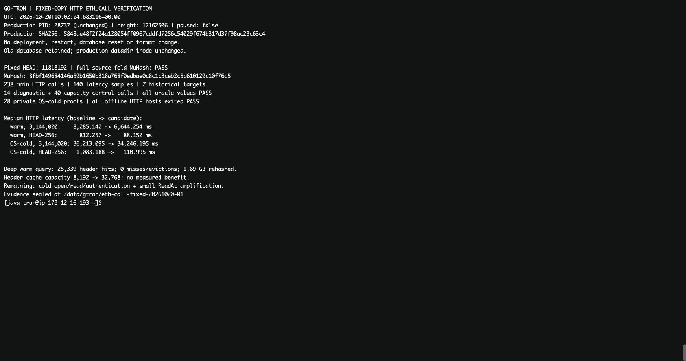

# 固定副本上的完整 HTTP eth_call 对比（2026-10-20）

验证完成。候选显著降低近端历史成本，但深历史仍受冷段读取、认证及小块随机访问限制。
本次没有推送、部署、重启或暂停生产服务。基线为线上源码
`9030ce7a31016491ece014ac76e5656ec149417e`，候选为 `4e6978dd0360ee7ea253cef5c62608e0c89ed407`。
这两个版本均使用 compact-v3 格式；这里的“基线”不是最初压缩优化之前的格式。

## 固定输入与核验

服务器工作目录：`/data/gtron/eth-call-fixed-20261020-01`。
固定 HEAD 为 **11,818,192**，TxNum **601,386,177**，区块哈希
`0000000000b454d09a46886a40d09d8cbec73812d013f57de1fc803784acfdf6`。
独立全量 source-fold MuHash 为
`8fbf149684146a59b1650b318a768f0edbae0c8c1c3ceb2c5c610129c10f76a5`，与完整持久化 HEAD 一致。
源状态行数为账户 **3,484,117**、generation **481**、KV **141,418,493**。

来源在持续运行。采集器依次保留 chaindata、history 的不可变 SST，独立复制所选 MANIFEST/WAL 前缀，
再固定冷 manifest（generation **5,101**）及其不可变伴随文件、ancient 文件。
没有尝试打开在线 Pebble 或停止/暂停进程；可变元数据与 WAL 没有硬链接到来源。
候选副本先通过 Pebble 恢复、最新 root/HEAD 绑定和全量 MuHash 重算才被接纳。
此采集是本次诊断的输入，不作为通用在线备份方案或已完成生产恢复演练的凭据。

两版使用同一输入与同一 HTTP 宿主。实际构造 `TronBackend`，执行生产 JSON-RPC Handler、
历史状态准备、TVM 和结果序列化；不是直接调用 storage reader 或内部扫描基准。
宿主没有 P2P、导入、冷发布或清理循环，两个 Pebble 和 ancient 均以只读方式打开。
每个进程加载并记录同一个 HEAD；退出时再检查 HEAD 未变。

服务器 Go **1.25.5**，原生 **CGO/Sapling** 构建。两版控制为 GOMAXPROCS=2、
GOMEMLIMIT=3GiB、hot/history 读缓存各 512MiB；外层 MemoryLimit=5GiB、CPUQuota=200%，nice=15、ionice=idle。
与生产服务共享主机，预算也不同于生产，结果用于相同输入与预算的串行对比，不等同于线上延迟或并发 p95。
服务器原始源码的 **2,129** 个非测试 Go/Rust/模块文件指纹已与两端 Git 版本逐一比对，一致。

## 请求与缓存条件

合约：`0xa4997124a328a4615eab437cede31da47a31b375`。
calldata：`0x9fa6a6e3`；与此前慢查询探针一致，省略 `from`。
每次真实 HTTP POST 到独立进程的 loopback 监听地址，不计 Nginx、SOCKS 或公网传输。

| 请求状态 | 期望 uint256 |
| --- | ---: |
| 3,144,020 | 6 |
| 3,144,021 | 7 |
| 5,000,000 | 63 |
| 9,000,000 | 207 |
| 11,817,936（HEAD−256） | 225 |
| 11,818,191（HEAD−1） | 225 |
| latest，固定为 11,818,192 | 225 |

先用固定副本上的 slot 0 核对；两个已知见证高度额外严格检查 6/7。
全部返回值又通过独立物化 before-image 参考折叠核对，未仅以两版本彼此相等作为正确依据。
参考实现不调用 `PersistentHistoryReader`、优化后的 first-match 或 query-tail cache，
检查账户 generation 和 Java storage row layout 在该合约历史中不变，收集并排序原始 before-image 后求各目标状态。
它复用经过认证的完整冷键迭代和基线 owning 热键迭代，并非另一套独立源数据或每个历史高度的全库 MuHash 重算。

三类有效性能样本分别记录：

- **同进程预热**：先跑完七个请求，再按 A/B、B/A 两个进程组测量；每高度、每版本五个样本。
- **新进程首查**：每个高度、版本重新打开宿主，记录第一个请求；每组三个样本，OS 缓存不受控。
- **私有文件 OS 冷缓存首查**：依据两版完整发现阶段的 read/pread 路径集合，复制为独立 inode；
  只对这些私有文件使用 fadvise，记录 mincore，再启动新进程并测第一个请求；每组两个样本。
  驻留率验证发生在进程启动前，启动本身的读取不计入 RPC 延迟。

不使用全局 `drop_caches`，不驱逐线上文件的页缓存。
带 strace 的发现阶段、预热请求和 CPU profile 工作负载均单独标记，不混入延迟表。
低样本量只报告中位数与完整范围，不估算 p95。

## 完整 HTTP 性能

共记录 **238** 次主实验 eth_call，其中 **140** 次进入性能表；其余为发现、预热及 profile 工作负载。
另有 **14** 次独立计数诊断及 **40** 次缓存容量对照请求，全部与 before-image 参考值一致。
七个高度的值分别为 **6、7、63、207、225、225、225**。

以下单位 ms，每格为“中位数 [最小值–最大值]”。低样本量不能推算 p95。

### 同进程预热

每高度、每版本 **5** 次。

| 目标高度 | 基线 9030ce7a | 候选 4e6978dd |
| --- | ---: | ---: |
| 3,144,020 | 8,285.142 [8,168.909–8,400.166] | 6,644.254 [6,599.063–6,711.774] |
| 3,144,021 | 8,294.989 [8,184.262–8,454.440] | 6,660.435 [6,621.608–6,713.309] |
| 5,000,000 | 7,044.026 [6,980.585–7,133.507] | 5,435.562 [5,404.501–5,538.009] |
| 9,000,000 | 3,631.170 [3,542.441–3,713.731] | 2,070.129 [2,043.880–2,091.491] |
| 11,817,936（HEAD−256） | 812.257 [800.758–826.497] | 88.152 [83.120–101.954] |
| 11,818,191（HEAD−1） | 22.134 [21.899–22.828] | 25.159 [19.083–29.881] |
| latest（固定 HEAD） | 3.039 [1.348–3.958] | 1.458 [1.190–5.012] |

### 新进程首查，OS 页缓存不受控

每高度、每版本 **3** 次。

| 目标高度 | 基线 9030ce7a | 候选 4e6978dd |
| --- | ---: | ---: |
| 3,144,020 | 9,264.357 [9,247.158–9,324.355] | 7,693.309 [7,680.695–7,731.163] |
| 3,144,021 | 9,548.583 [9,408.879–9,561.844] | 7,763.857 [7,717.306–7,899.828] |
| 5,000,000 | 7,842.167 [7,824.375–7,936.994] | 6,271.876 [6,241.733–6,416.915] |
| 9,000,000 | 3,980.852 [3,957.639–4,137.754] | 2,384.536 [2,373.922–2,387.855] |
| 11,817,936（HEAD−256） | 864.230 [863.525–1,054.419] | 99.203 [90.661–127.120] |
| 11,818,191（HEAD−1） | 25.219 [24.736–28.777] | 23.941 [22.220–24.405] |
| latest（固定 HEAD） | 6.452 [6.421–9.681] | 6.300 [5.599–6.404] |

### 私有文件 OS 冷缓存后启动，首个请求

每高度、每版本 **2** 次。

| 目标高度 | 基线 9030ce7a | 候选 4e6978dd |
| --- | ---: | ---: |
| 3,144,020 | 36,213.095 [35,487.843–36,938.347] | 34,246.195 [33,907.756–34,584.633] |
| 3,144,021 | 35,886.698 [35,873.085–35,900.311] | 34,431.854 [34,399.932–34,463.775] |
| 5,000,000 | 29,494.997 [29,317.629–29,672.366] | 27,842.407 [27,749.479–27,935.334] |
| 9,000,000 | 12,466.313 [11,981.448–12,951.178] | 11,499.776 [9,751.387–13,248.165] |
| 11,817,936（HEAD−256） | 1,083.188 [909.481–1,256.895] | 110.995 [107.244–114.746] |
| 11,818,191（HEAD−1） | 46.425 [44.055–48.794] | 48.381 [43.631–53.130] |
| latest（固定 HEAD） | 18.110 [17.519–18.701] | 18.787 [18.561–19.012] |

近端 HEAD−256 的预热中位数 **812.257→88.152 ms（约 9.21 倍）**，私有 OS 冷缓存首查
**1,083.188→110.995 ms（约 9.76 倍）**。热尾部复用在完整 HTTP 链路中生效。
深历史 3,144,020 的预热中位数 **8,285.142→6,644.254 ms，下降 19.8%**；
私有 OS 冷缓存首查 **36,213.095→34,246.195 ms，仅下降 5.4%**。
HEAD−1 / latest 的毫秒级差异受 GC、调度及先前请求影响，不据这些小样本宣称确定的回退或加速。

私有输入共 **11,428** 个文件、**157,021,873,555 B**，与采集副本 inode 不同；覆盖发现阶段两版全部 read/pread 路径。
28 次驱逐前置证明的最大驻留率为 **0.0000339061%**，并非绝对零。
这是“启动前冷、首个 HTTP 请求”的结果：进程初始化会预读元数据，不能称为请求开始瞬间所有字节均冷。

## 剩余瓶颈：重复读取与认证，而非缓存容量不足

候选独立诊断的深历史 3,144,020 / 3,144,021 每次触及 **4,223** 个不同的头内容键，
小于现有 **8,192** 项容量。首次诊断 4,223 次 miss，后续每次 **25,339 hit、0 miss、0 eviction**，
却仍重读并计算 BLAKE2b 的压缩首块总量 **1,689,745,562 B**。
5M 为 **1,358,391,551 B / 3,344 个键**；9M 为 **490,725,138 B / 1,135 个键**。
这些是累计认证字节，不是不同数据量、磁盘占用或实际设备读量。

直接原因见 `core/state/snapshots/history_header_cache.go`：跨 reader 命中之前必须
`readCompressedBlock(0)` 并 `blake2b.Sum256(comp)`，随后才查解码头缓存。
缓存只保留 128 B 前缀；reader 内可以复用，跨 open 仍重新读取当前完整压缩块。
这保留了同 inode、大小、mtime 下损坏也可发现的安全性质。不能简单用 stat 结果代替内容认证。
平均同一内容键约六次访问是观察到的读取放大，尚未做逐逻辑键的六次归因，不能把它写成六个确定业务查询。

预热深历史 3,144,020 的宿主进程每请求计数中位数：

| 指标 | 基线 | 候选 |
| --- | ---: | ---: |
| CPU 时间（user+system） | 8,686.405 ms | 6,918.359 ms |
| 累计分配（TotalAlloc 差） | 5.168 GB | 3.587 GB |
| rchar | 2.057 GB | 2.057 GB |
| syscr | 1,231,453 | 1,231,453 |
| GC 次数 | 26 | 18 |
| read_bytes | 0 | 0 |

候选减少了约 1.58 GB 的累计分配和相应 CPU，但两版冷读取量及读取调用数基本相同。
上述分配不是 RSS；rchar 是累计读取字符计数，不是去重数据。
私有 OS 冷缓存首查候选 CPU 约 **9,869.591 ms**、墙钟 **34,246.195 ms**，
`/proc/self/io.read_bytes` 约 **3.121 GB**，首查 rchar **2.074 GB**、syscr **1,233,647.5**（两次中位数）。
预读、页粒度和内核记账可使 read_bytes 大于应用 rchar；这些不是独立设备吞吐测量。
冷查额外延迟与存储读取等待一致，不能仅靠减少 Go 分配解决。

候选 CPU profile 独立采样约 20.15 秒，20.70 CPU 秒；从七高度预热工作负载开头采样，主要覆盖深历史，
不是七高度等权分布，也不混入性能表：

| CPU flat 热点 | 时间 | 占样本 |
| --- | ---: | ---: |
| BLAKE2b hashBlocksAVX2 | 5.94 s | 28.70% |
| Syscall6 | 5.57 s | 26.91% |
| memclrNoHeapPointers | 1.39 s | 6.71% |
| Zstd 主 sequence decoder | 0.25 s | 1.21% |
| Snappy decoder | 0.21 s | 1.01% |

累计调用栈中 `firstStateDomainChangeByKey` 为 **76.76%**，
`readStateAccountLatestAsOf` 为 **32.03%**，`readStateKVAsOf` 为 **44.73%**；
`readStateKVBatchAsOf` 为 **19.66%**。`readHeaderPrefix` 累计 **39.23%**，
accessor 目录项读取累计 **13.38%**，footer layout 累计 **8.74%**。
这些累计栈互相嵌套，不能相加。
瓶颈落在历史状态定位/读取和认证链路，当前证据不支持把主要成本归给 TVM 指令执行或 Zstd 解压。
`history_key_oriented_v6.go` 的目录二分每次目录项包含多次小 ReadAt，
压缩 footer/block table 也在重新 open 时解析；大量小读取与 profile、百万级 syscr 相互吻合。

## 排除的假设与容量对照

固定未索引尾部为 **662 块、379,603 条逻辑变化**。其中 System owner **3,083 行**，
按缓存自身规则计费 **918,987 B**，低于 16,384 行 / 8 MiB 预算（此计费不是实测堆存活量）。
深历史每次 System owner 一次完整扫描入缓存、随后 **129 次命中**；合约 owner 也入缓存并命中。
14 次诊断没有出现 owner、行数或字节预算拒绝。因此本次深历史慢不能解释成热尾部缓存饥饿或超预算回退。

另编译独立 overlay，只将 `historyHeaderCacheEntries` 从 8,192 改为 32,768，
不修改候选源码或正式对比二进制。A/B 后 B/A，四高度、每版本三次预热有效样本，另有预热请求：

| 高度 | 原候选 8,192（ms） | 扩为 32,768（ms） |
| --- | ---: | ---: |
| 3,144,020 | 6,594.391 | 6,645.454 |
| 9,000,000 | 2,024.569 | 2,055.332 |
| HEAD−256 | 83.069 | 84.213 |
| latest | 3.280 | 3.180 |

没有观察到容量扩大带来的收益；小差异不作显著性判断。实际工作集已能装下，扩大该缓存不应作为下一项主要优化。
本次两版相同 compact-v3 输入，候选并未造成深历史倒退；这不是压缩前后格式对照，
不能凭这些数字断言最初压缩优化完全没有成本。压缩块与认证粒度耦合确实放大了当前少量头数据的读取成本。

## 下一步方案与正确性约束

1. **先减少同一请求中的冷段重复 open/read。** 在固定 HEAD/TxNum 的请求 reader 内，
   为低层 AccountLatest/envelope、generation、KV 结果增加有界正/负缓存。
   当前高层 Account/Code/Storage 缓存没有覆盖所有 hydration 和底层访问路径。
   然后把可同时确定的不同 owner/domain/key 请求合并为一次段访问，复用目录、footer、已认证的 reader。
   现有 batch 接口限定同 owner/generation/domain，系统属性批量读取已经受益，但异类读取仍各走一遍冷段。
   先做逐逻辑查询 span/字节计数，再用相同固定副本验证它究竟消除了哪些重复访问。
2. **压缩小 ReadAt 与重复分配。** 对目录二分所需窗口做有界合并读取，在同一认证 reader 生命周期内复用已解析目录和 block table；
   为压缩输入 buffer 做严格有界复用，减少 make/memclr/GC。单独报告读取调用、认证字节、累计分配和 HTTP 延迟，
   不能仅给内部循环 benchmark。它不应绕开当前内容损坏检测。
3. **解决深历史的段数放大。** 评估可重建、绑定已发布 manifest 的 key→segment 目录/过滤层，
   将“证明该 key 在几千段不存在”的工作从逐段打开变为经过认证的定位；或者设计小的独立认证头块，
   避免读 128 B 头先抓整个压缩首块。先验证空间代价、缺失键/错误过滤、发布切换和损坏回退。
   优先保留原文件作为真值与可回退路径；派生索引与请求缓存原则上不要求删库重同步。

必须维持 `(targetTxNum, headTxNum]` 首变化的 TxNum/Seq 顺序、冷热重叠择早、generation 隔离、
历史合约元数据的 Java storage row layout、请求取消，以及固定视图下返回字节的独立所有权。
请求级复用不能扩大为跨请求仅凭 inode/mtime 的信任；派生目录必须绑定完整性证明并能安全回退。
下一次代码修改仍需 archive、MuHash、快照恢复与继续执行回归，再在本副本复跑完整 HTTP 对照。
本轮只补齐测量和定位，没有开始新的产品代码修改。

## 正确性、运行状态及复现

固定 HEAD 的全源 MuHash 已重算通过；before-image 参考核对该合约 **1 个账户版本、0 个元数据变化、225 个 slot 版本**，
generation=0，row key 为 `6e8935d029f96ae6e183f6b344312f2d00000000000000000000000000000000`。
这验证七个目标返回值，不代表每个目标高度都全库重算 MuHash，也不代表已在新固定副本执行完整的全库快照恢复演练。
候选既有的 Sapling archive/MuHash/恢复回归见 [此前验证](cold-query-tail-optimization-20261020.md)；本轮未改产品代码。
全部离线 HTTP 宿主以只读方式打开数据、退出时检查同一 HEAD，78 个主实验进程全部正常退出。

封存时间 **2026-10-20 09:47:44 UTC**，生产仍为 PID **28737**、原 SHA256
`5848de48f2f24a128054ff0967cddfd7256c54029f674b317d37f98ac23c63c4`，
高度从副本 11,818,192 推进到 **12,098,213**，同步未暂停；原目录 inode **94642617**，旧库保留。
最终只读复核 **10:02:24 UTC**，生产 PID/SHA 仍相同，高度继续推进至 **12,162,506**，同步未暂停。
离线任务均有完成回执；固定副本和私有冷缓存输入保留用于下一轮复测，没有修改服务参数或自动上线。

服务器原始数据、原生测试二进制和大体积 strace 位于 `/data/gtron/eth-call-fixed-20261020-01`。
轻量证据下载包 SHA256：`f6b559cd6a3716f6818138c12a751ebe66247c81600618ae2649b116ed34c770`。
包内含原始逐请求时间、宿主 CPU/分配/io 计数、三组性能汇总、独立 oracle、完整 census、profile、
源码/原生二进制指纹、冷缓存 mincore/inode 证明及各阶段脚本、失败后修复记录。
发现阶段 strace 不计入延迟，原始大文件仅保留服务器；证据 `.go` 文件本地改为 `.go.txt`，映射和原始哈希不变。
宿主 ready.json 的 `%x` 对 Hash.String() 产生 128 字符 ASCII 十六进制，校验程序先解一层得到真实 32 字节 root/hash，未将其冒充另一根。

本地校验：

```bash
python3 docs/dev/evidence/20261020-eth-call-fixed/verify.py
```

[全部性能汇总](evidence/20261020-eth-call-fixed/server/summary.json) ·
[逐请求资源计数](evidence/20261020-eth-call-fixed/server/joined-request-metrics.json) ·
[独立返回值参考](evidence/20261020-eth-call-fixed/server/oracle.json) ·
[全量 MuHash](evidence/20261020-eth-call-fixed/server/census.json) ·
[诊断计数](evidence/20261020-eth-call-fixed/server/diagnostic-counts.json) ·
[CPU profile](evidence/20261020-eth-call-fixed/server/profile-candidate/cpu.pb.gz) ·
[最终回执](evidence/20261020-eth-call-fixed/server/final-proof.json)


